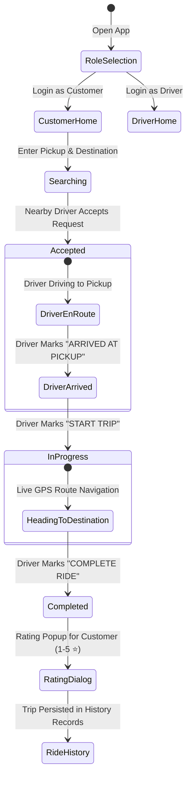

# 🚕 VeloCity - On-Demand Ride-Hailing & Live Match Platform
> **Project Report & Architectural Guide**

---

## 📌 Executive Summary
**VeloCity** (RideMatch) is a modern, native Android application engineered for real-time ride-hailing and driver-passenger dispatching. Built using **Java**, **MapLibre GL**, **OpenStreetMap (OSM)**, and **Google Firebase**, VeloCity provides a seamless end-to-end urban mobility experience.

Key capabilities include automated geo-location search, real-time driver matching, multi-stage trip tracking with dynamic ETA countdowns, post-ride passenger feedback ratings, and complete trip history logging for both customers and drivers.

---

## 🏗️ Technical Architecture & Stack

```
┌────────────────────────────────────────────────────────────────────────┐
│                        ANDROID MOBILE CLIENT (Java)                    │
│  ┌──────────────────────┬──────────────────────┬────────────────────┐  │
│  │ Customer Home / Map  │  Driver Home / Nav   │  Ride History View │  │
│  └──────────┬───────────┴──────────┬───────────┴──────────┬─────────┘  │
└─────────────┼──────────────────────┼──────────────────────┼────────────┘
              │                      │                      │
              ▼                      ▼                      ▼
┌──────────────────────────┐  ┌────────────────────┐  ┌──────────────────┐
│   Firebase Auth / Cloud  │  │ MapLibre GL SDK /  │  │ Photon Geocoding │
│  Firestore (Real-time)   │  │ OpenStreetMap      │  │ & OSRM Routing   │
└──────────────────────────┘  └────────────────────┘  └──────────────────┘
```

| Component | Technology / Library | Purpose |
| :--- | :--- | :--- |
| **Language** | Java 11 / Android SDK | Native Android Application Code |
| **UI Framework** | Material Design 3, XML | Responsive cards, inputs, and custom visual styling |
| **Map Engine** | MapLibre GL SDK (`11.8.0`) | Map rendering, markers, camera bounds & polyline routes |
| **Tile Provider** | OpenStreetMap (OSM) Tiles | Global open-source raster map tiles |
| **Authentication** | Firebase Auth | Secure email/password login and session management |
| **Database** | Firebase Firestore | Real-time NoSQL cloud synchronization for location & rides |
| **Networking** | OkHttp 4 (`4.12.0`) | HTTP tile interceptors with custom User-Agent headers |
| **Geocoding** | Photon Nominatim API | Real-time location search and autocomplete |
| **Routing** | OSRM Route Engine | Driving distance and duration calculations |

---

## 📊 Database Schema (Cloud Firestore)

### Collection: `users`
Stores profile data and driver online availability states.
```json
{
  "uid": "usr_9812734",
  "name": "Alex Johnson",
  "email": "alex@velocity.com",
  "role": "customer", // or "driver"
  "vehicleModel": "White Swift Dzire", // drivers
  "vehicleNumber": "MH-12 AB 1234",    // drivers
  "isOnline": true,
  "updatedAt": "Timestamp"
}
```

### Collection: `driverLocations`
Maintains live driver GPS pings for spatial distance queries.
```json
{
  "driverId": "drv_5541290",
  "latitude": 18.5204,
  "longitude": 73.8567,
  "isOnline": true,
  "updatedAt": "Timestamp"
}
```

### Collection: `rides`
Tracks the complete lifecycle, route details, and post-ride reviews.
```json
{
  "rideId": "ride_0019283",
  "customerId": "usr_9812734",
  "driverId": "drv_5541290",
  "driverName": "Rahul Sharma",
  "vehicleDetails": "White Swift Dzire (MH-12 AB 1234)",
  "pickup": "Swargate, Pune",
  "destination": "Phoenix Marketcity, Viman Nagar",
  "pickupLatitude": 18.5018,
  "pickupLongitude": 73.8636,
  "destinationLatitude": 18.5620,
  "destinationLongitude": 73.9168,
  "distanceKm": 11.4,
  "estimatedFare": 220,
  "status": "completed", // "searching" | "accepted" | "arrived" | "in_progress" | "completed"
  "rating": 5.0,
  "review": "Smooth driving and quick arrival!",
  "createdAt": "Timestamp",
  "completedAt": "Timestamp"
}
```

---

## 🔁 Complete System Workflow



---

## 📱 Detailed Screen-by-Screen Guide

| # | Tab / Screen Name | Primary Features & Implementation Details |
| :-: | :--- | :--- |
| **1** | **Role Selection & Welcome** (`MainActivity`) | • Prominent VeloCity branding header with custom vector logo.<br>• Clean Material 3 selection cards for **Customer**, **Driver**, and **Log In**. |
| **2** | **Authentication** (`LoginActivity` & `RegisterActivity`) | • Email and password input validation.<br>• Dynamic role registration (`customer` / `driver`).<br>• Vehicle details capture for driver onboarding. |
| **3** | **Customer Home Dashboard** (`CustomerHomeActivity`) | • Real-time location search via Photon Geocoding API.<br>• Direct access buttons: **"Find a Ride & View Route"**, **"Explore Map View"**, and **"My Ride History"**. |
| **4** | **Driver Dashboard** (`DriverHomeActivity`) | • **GO ONLINE / GO OFFLINE** status toggle.<br>• Live earnings counter updating dynamically from completed trips.<br>• Incoming ride request popup notification with Accept/Reject actions. |
| **5** | **Driver Preferences & Filters** (`DriverFilterActivity`) | • Customizable fare threshold and search radius filters.<br>• Mode switches for nearest pickup vs highest fare priority. |
| **6** | **Interactive Route Map** (`RideMapActivity`) | • Fullscreen MapLibre GL map with OpenStreetMap raster tiles.<br>• Pickup and Destination marker placement with custom cab icons (`ic_cab`).<br>• Real-time route polyline and dynamic fare calculation engine (`FareCalculator`). |
| **7** | **Live Multi-Stage Tracking** | • Stage 1 (`accepted`): Driver en route to pickup point with ETA.<br>• Stage 2 (`arrived`): Driver arrival alert at pickup point.<br>• Stage 3 (`in_progress`): Live navigation towards destination with continuous coordinate updates. |
| **8** | **Post-Ride Rating Dialog** | • Automatic star rating popup (1–5 stars) upon trip completion.<br>• Optional text feedback review field saved to Firestore ride documents. |
| **9** | **Ride History** (`RideHistoryActivity`) | • Comprehensive past trip records for both Customers and Drivers.<br>• Formatted trip cards displaying date, addresses, fare, distance, driver/passenger name, rating, and status badges. |

---

## 🛠️ Verification & Deployment
- **Gradle Build**: Verified with `:app:assembleDebug`.
- **Linter / LSB Analysis**: Passed with 0 errors across all activity and adapter source files.
- **Device Deployment**: Successfully tested and deployed to Android physical test device (`df595010`).

---

## 📜 How to Use This Report Guide
1. **Introduction & Motivation**: Use the **Executive Summary** and **Technical Stack** sections for your project introduction.
2. **System Design**: Insert the **Mermaid Flowchart** and **Firestore Database Schema** into the System Architecture chapter of your report.
3. **Implementation Details**: Reference the **Screen-by-Screen Guide** for your application layout and UI documentation.
